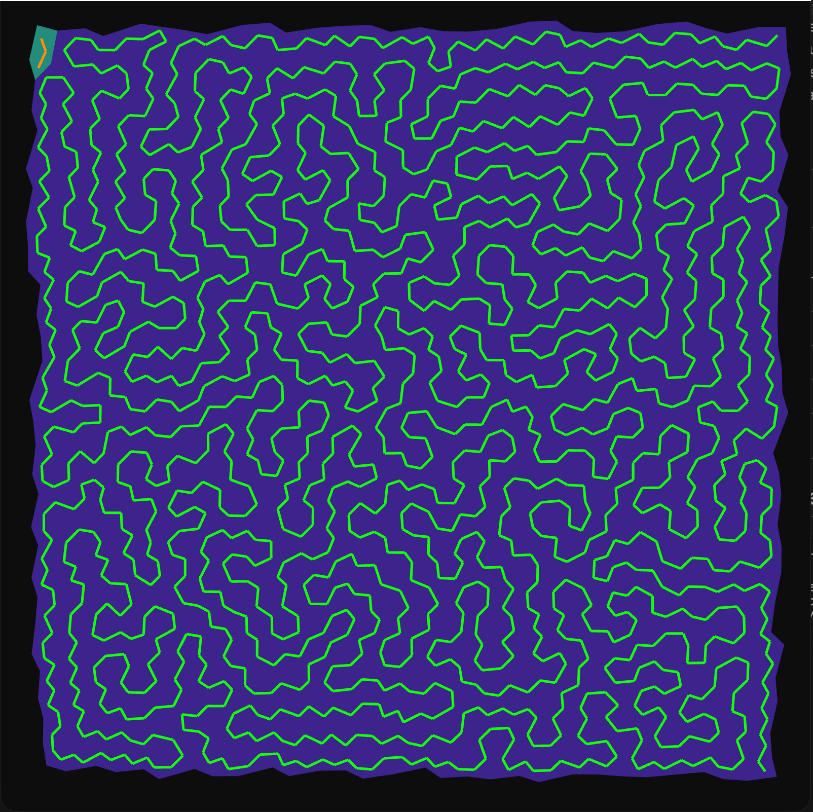
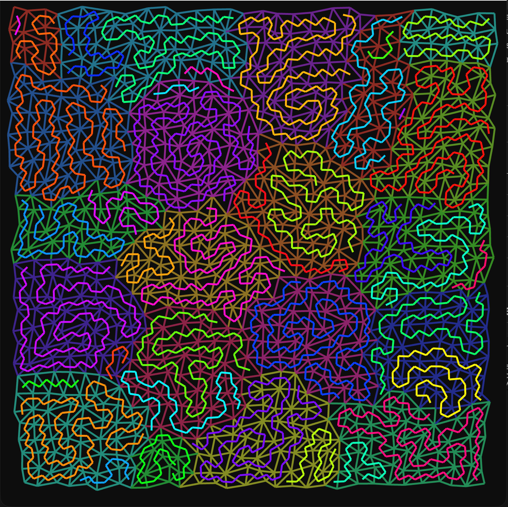
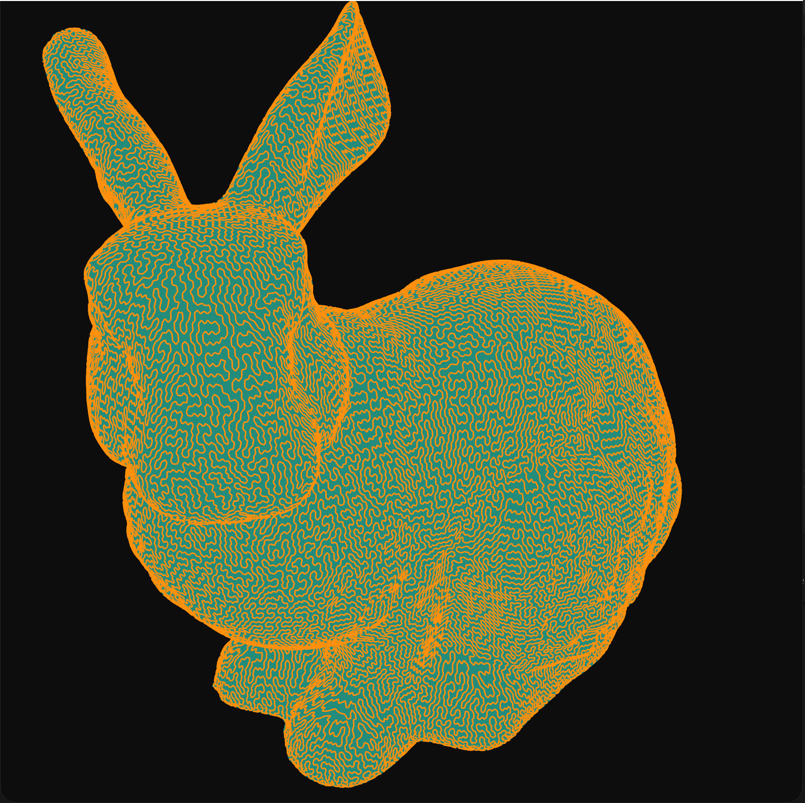
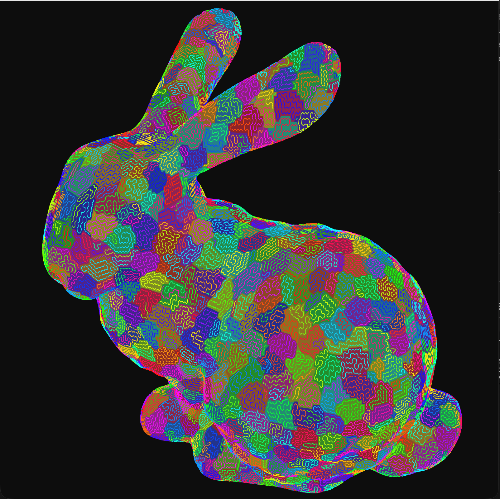
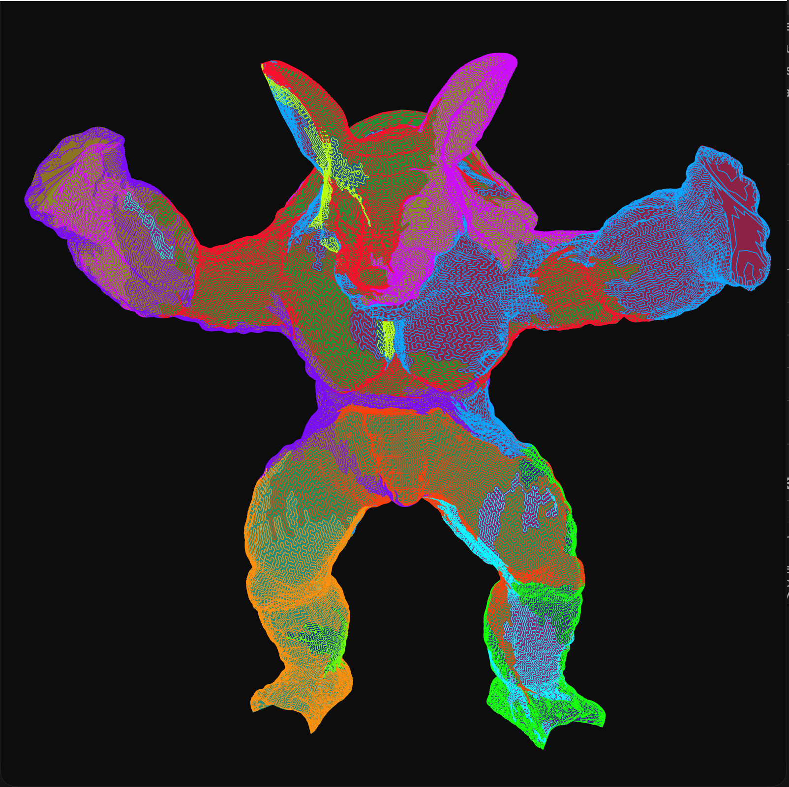
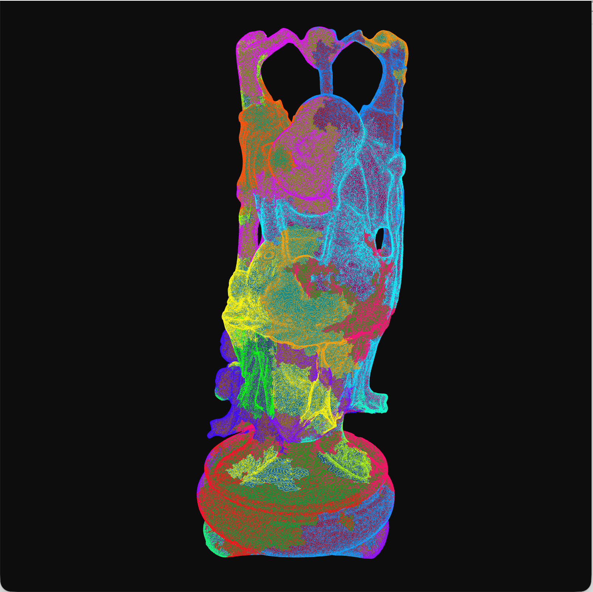

# ETA — Triangle Strip Generator

An implementation of the [*Enhanced Tunnelling Algorithm (ETA)*](https://www.researchgate.net/publication/221622706_Partitioning_Meshes_into_Strips_using_the_Enhanced_Tunnelling_Algorithm_ETA) for decomposing triangle meshes into continuous triangle strips.

The algorithm treats the mesh as a dual graph and uses bounded Depth-First Search (DFS) tunneling to find a minimal path cover. It was highlighted by AMD researchers ([*Towards Practical Meshlet Compression*](https://arxiv.org/abs/2404.06359), VMV 2024) as a practical alternative to mixed-integer linear programming (MILP) when ordering primitives for meshlet compression.

---

## Gallery

| 2D Triangles | 2D Triangles (Meshlets) |
| :---: | :---: |
|  |  |
| **Bunny** | **Bunny (Meshlets)** |
|  |  |
| **Armadillo** | **Happy Buddha** |
|  |  |

---

## Implementation Details

The solver builds a dual graph using an adjacency array, where faces serve as nodes and shared edges define adjacency.

Strips are stored as doubly linked lists of triangle indices. This makes it cheap to split strips apart or join them together during tunneling without reallocating arrays.

### Tunneling Search
ETA reduces the number of strips by finding reconnection paths (tunnels) between strip endpoints:
* Strips crossing the local star region (up to 100 triangles) are split at the boundary before searching.
* The search checks strip IDs before merging to avoid forming loops.
* DFS is bounded by a maximum depth of 250 and 10,000 iterations per endpoint.

### Global Path Search
If local tunneling stops finding merges on a full mesh, the solver switches to a guided heuristic:
1. It runs a Breadth-First Search (BFS) to measure topological distance to the target endpoint.
2. It sorts neighboring triangles by this distance so DFS explores paths toward the target first.

### Meshlets
Using the `meshlets` argument partitions the mesh with `meshoptimizer` (<= 64 vertices, <= 126 triangles) before running the strip generator on each cluster separately.

---

## Benchmarks

Measured on an Apple M3 MacBook Air across full meshes:

| Model | Triangles | Strips | Time |
| :--- | :---: | :---: | :---: |
| Stanford Bunny | 69,451 | 1 | 3.1 s (3 088 ms) |
| Armadillo | 345,944 | 11 | 3 min 08 s (188 074 ms) |
| Stanford Buddha | 1,087,716 | 32 | 2 min 38 s (157 638 ms) |

---

## Dependencies

* C++20 compiler (GCC 11+, Clang 13+, MSVC 2019+)
* CMake (>= 3.20)
* OpenGL (>= 3.3 Core Profile), GLEW, GLFW
* GLM, meshoptimizer, fast_obj

---

## References

1. **[Partitioning Meshes into Strips using the Enhanced Tunnelling Algorithm (ETA)](https://www.researchgate.net/publication/221622706_Partitioning_Meshes_into_Strips_using_the_Enhanced_Tunnelling_Algorithm_ETA)** by M. B. Porcu and R. Scateni.
2. **[Towards Practical Meshlet Compression](https://arxiv.org/abs/2404.06359)** by B. Kuth et al.
